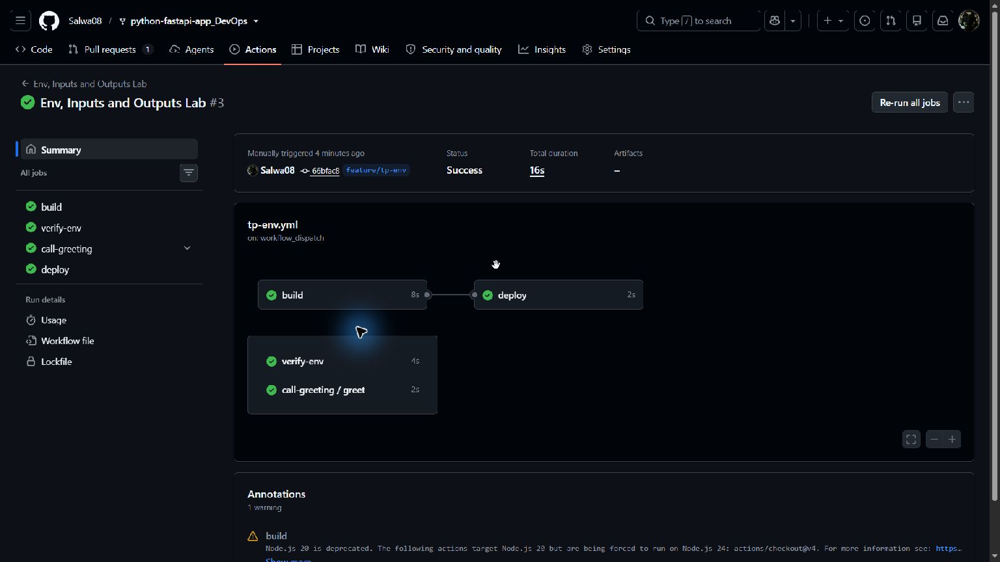

# TP 06 - Vérifications

Branche de rendu : [`feature/tp-env`](https://github.com/Salwa08/python-fastapi-app_DevOps/tree/feature/tp-env),
créée depuis `origin/main` au commit `ca8cd780844a122b5d01497d8c54875160c057df`.

## Exécutions GitHub Actions

Chaque lancement manuel a été effectué après le push du commit correspondant.
L'identifiant du commit (`headSha`), le succès des jobs et les valeurs affichées
ont été vérifiés avec GitHub CLI.

| Étape | Commit exécuté | Paramètres | Résultat |
| --- | --- | --- | --- |
| Inputs et debug désactivé | `3c97398ebfd117ace507020a0c8988d406a63cf2` | `environment=staging`, `version=1.0.0`, `debug=false` | [Succès : run 44624595703](https://github.com/Salwa08/python-fastapi-app_DevOps/actions/runs/44624595703) |
| Outputs et debug activé | `0ce20cc874f8412b9fb1434d2a9798449d5bce28` | `environment=staging`, `version=1.0.0`, `debug=true` | [Succès : run 44625088276](https://github.com/Salwa08/python-fastapi-app_DevOps/actions/runs/44625088276) |
| Workflow réutilisable et validation finale | `66bfac88976472e9865032d13283b32985210b2d` | `environment=staging`, `version=1.0.0`, `debug=true` | [Succès : run 44625614636](https://github.com/Salwa08/python-fastapi-app_DevOps/actions/runs/44625614636) |

Dans le premier run, `Print debug information` est ignorée (`skipped`). Dans
les deux suivants, elle réussit et affiche le SHA du commit exécuté.

Dans le run final :

- `build`, `verify-env`, `deploy` et `call-greeting / greet` réussissent ;
- `build` affiche `Full version: 1.0.0-2026-11-19` ;
- `deploy` affiche `Deploying 1.0.0-2026-11-19 to staging` ;
- `verify-env` affiche `APP_NAME in another job is ''` ;
- le workflow réutilisable affiche `Bonjour staging`.

Les résultats et les détails des steps sont conservés dans
[`preuves/tp06-runs.json`](preuves/tp06-runs.json). Les commits de preuves
suivant `66bfac8` ne changent pas les workflows : ils documentent cette
exécution, sans lancer de run supplémentaire.

## Capture de l'exécution réussie

Capture réalisée dans Microsoft Edge sur la page du run final. Le statut
`Success`, le commit `66bfac8` et les jobs `build` et `deploy` réussis y sont
visibles, ainsi que `verify-env` et `call-greeting / greet`.

## Vérifications locales

- `actionlint` 1.7.12 : syntaxe et expressions des deux nouveaux workflows valides.
- Exécution des steps Bash dans des processus séparés : propagation des
  variables aux steps suivantes, isolation entre jobs et transmission de la
  version vérifiées.
- Les inputs sont transmis aux scripts par `env`, puis lus dans des variables
  shell entre guillemets ; une chaîne contenant `$(...)` reste une donnée.
- `git diff --check` : aucune erreur d'espacement.

## Déclenchements et branche par défaut

Trois runs manuels du TP ont été lancés, chacun sur son commit. Aucun run
supplémentaire n'a été déclenché pour les seuls commits de documentation.
Le workflow du TP est limité à `workflow_dispatch`, et le workflow réutilisable
à `workflow_call`.

La branche `feature/tp-env` a servi temporairement de branche par défaut pour
permettre les lancements manuels. `main` a ensuite été rétablie et vérifiée
comme branche par défaut. Aucun changement du TP 06 n'a été fusionné dans `main`.
