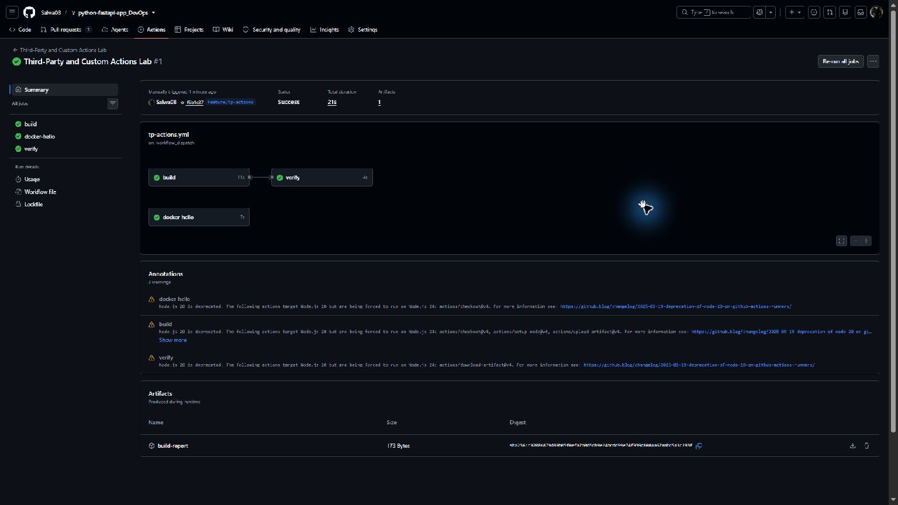

# TP 07 - Exécution et preuves

Branche de rendu : [`feature/tp-actions`](https://github.com/Salwa08/python-fastapi-app_DevOps/tree/feature/tp-actions),
créée depuis `origin/main` au commit `ca8cd780844a122b5d01497d8c54875160c057df`.

## Run vérifié

Le [run 44637088519](https://github.com/Salwa08/python-fastapi-app_DevOps/actions/runs/44637088519)
a été lancé manuellement après le push du commit
`f5b1c3750dd4f3d020c5496f062454806dd1aa3b`. Son `headSha` a été vérifié,
ainsi que le succès de ses trois jobs :

- `build` : action composite, Node.js 20, génération et envoi du rapport ;
- `verify` : téléchargement de `build-report` et affichage de `report.txt` ;
- `docker-hello` : construction de l'image Alpine et exécution de l'action Docker.

Les logs confirment `Building my-app v1.0.0`, `Build id is my-app-1.0.0`
et `Hello, GitHub Actions`.

Les métadonnées du run, des steps, de l'artefact et les mesures ci-dessous
sont conservées dans [`preuves/tp07-run.json`](preuves/tp07-run.json).
Le commit de preuves suivant `f5b1c37` ne change pas les workflows ni les actions.

## Artefact build-report

L'[artefact build-report](https://github.com/Salwa08/python-fastapi-app_DevOps/actions/runs/44637088519/artifacts/14585385887)
a été téléchargé et contrôlé. Ses métadonnées le rattachent au même commit
que le run. Le fichier contient une ligne, également affichée par `verify` :

```text
Node.js v20.20.2 - 2026-11-19T23:22:32Z
```

Une copie est disponible dans [`preuves/tp07-report.txt`](preuves/tp07-report.txt).

## Comparaison des temps : composite et Docker

Mesures tirées des horodatages UTC `startedAt` et `completedAt` des steps
du même run, avec une résolution d'une seconde :

| Action | Début | Fin | Durée mesurée |
| --- | --- | --- | --- |
| Composite - `Run build info action` | 23:22:28 | 23:22:28 | 0 s à cette résolution, donc moins d'une seconde |
| Docker - `Run Docker hello action` | 23:22:28 | 23:22:30 | environ 2 s |

La composite exécute directement ses commandes Bash sur le runner. La step
Docker comprend ici la construction de l'image `alpine:3.20` et le lancement
du conteneur, visibles dans les logs, ce qui ajoute un coût de préparation.
Cette observation ponctuelle dépend du cache, du réseau et du runner ; elle
ne constitue pas un benchmark général. Les durées totales des jobs ne sont
pas directement comparables, car `build` effectue aussi d'autres opérations.

## Capture de l'exécution réussie

Capture réalisée dans Microsoft Edge : le statut `Success`, le commit
`f5b1c37`, les trois jobs réussis et l'artefact `build-report` sont visibles.



## Vérifications et déclenchements

- `actionlint` 1.7.12 : workflow valide ; métadonnées des actions vérifiées.
- Scripts Bash : rapport sur une ligne, inputs par défaut et personnalisés,
  output composite, absence d'évaluation des inputs et entrypoint vérifiés.
- Script Docker conservé avec des fins de ligne LF et le bit exécutable Git.
- Expérience `checkout@main` enregistrée, puis retour à `@v4` avant exécution.
- Un seul run manuel du TP a été nécessaire ; le commit de preuves n'en lance pas.
- `main` est rétablie comme branche par défaut et n'a pas reçu les changements du TP.

GitHub affiche des avertissements de dépréciation pour le runtime interne
des actions `@v4` demandées par l'énoncé ; le run réussit. La version de Node.js
configurée pour le rapport reste bien la version 20, vérifiée dans l'artefact.
